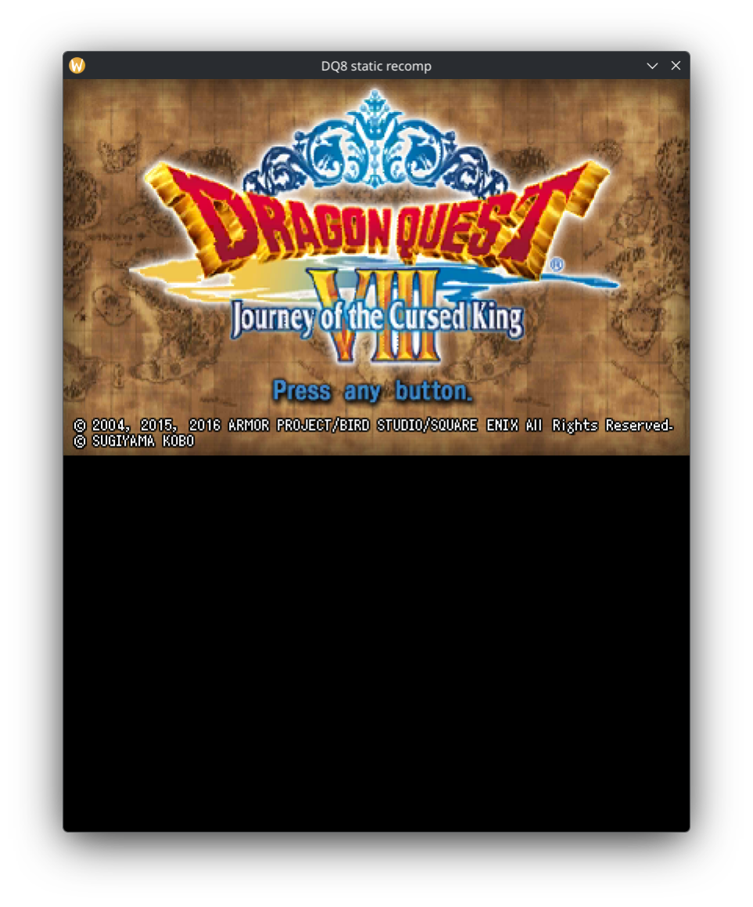
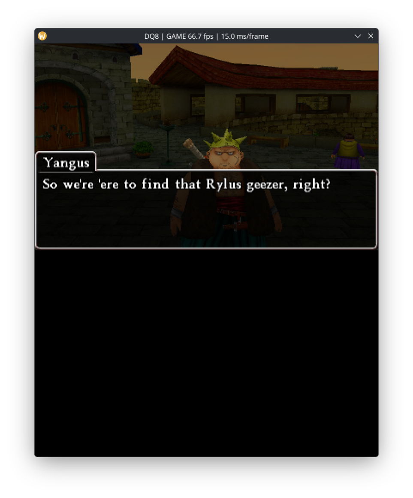
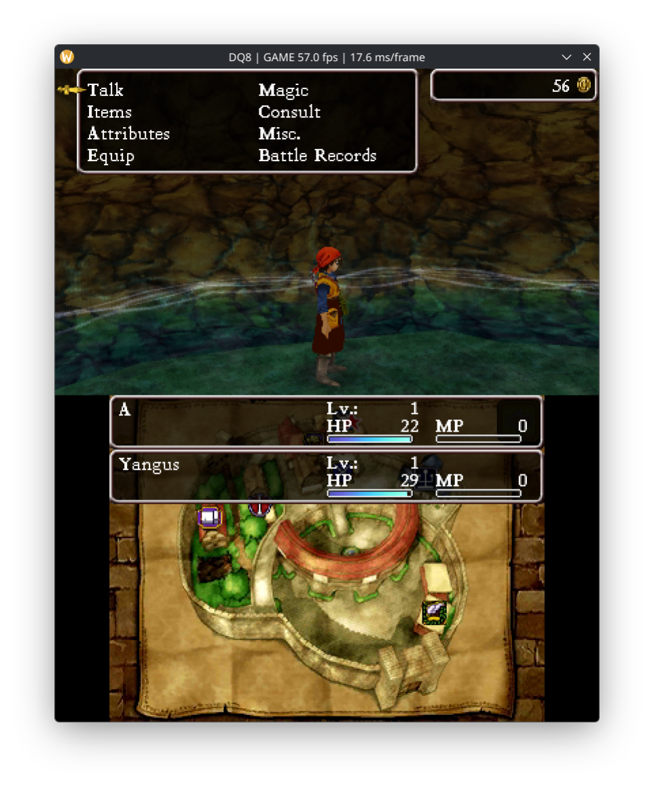
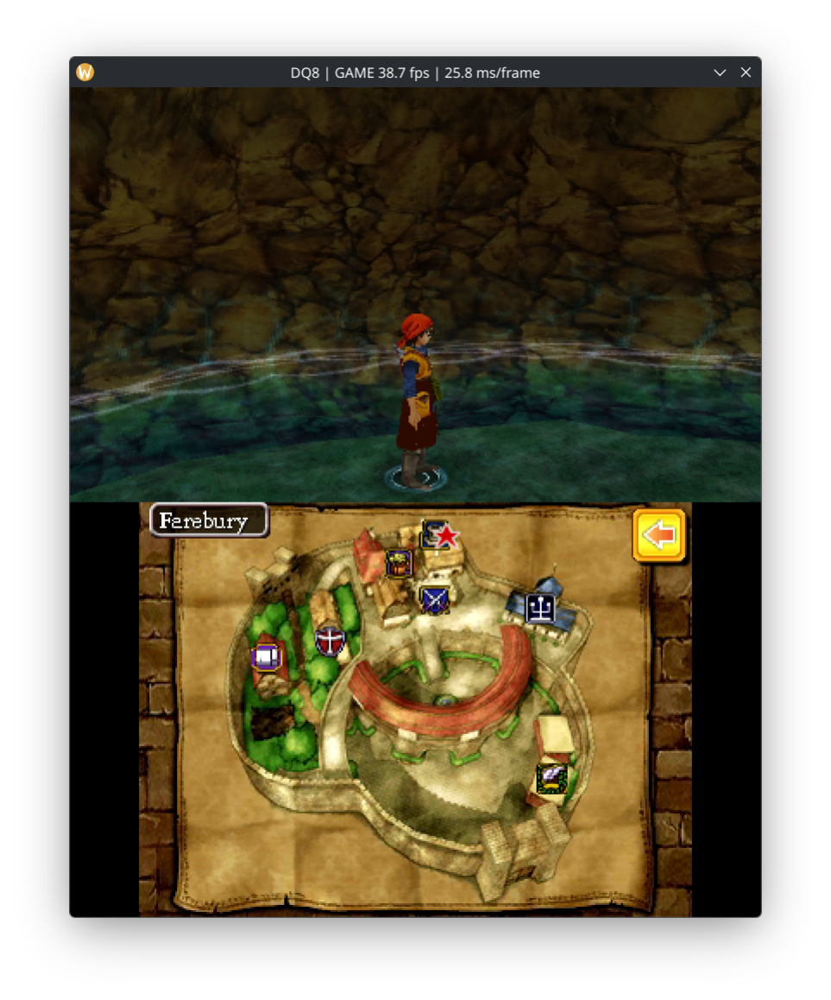

# DQ8-3DS-Recomp

**Dragon Quest VIII: Journey of the Cursed King (3DS) — static recompilation to C, running natively on PC.**

This project takes the game's own ARM code, statically recompiles it to portable C, links it with a
native runtime (input, audio, filesystem, savestates) and a from-scratch PICA200 (3DS GPU) renderer
with an OpenGL backend — and runs the game as an ordinary desktop application.

> **Work in progress.** The game boots, the intro movie, menus, the 3D world and in-game dialogue all
> render and run; performance and rendering-correctness work is ongoing.

> **Legal note.** This repository contains **no game data whatsoever** — no ROM, no `code.bin`, no
> `romfs`, no saves. You must supply files extracted from **your own legally acquired copy** of the
> game. The project is intended for preservation and research.

---

## Screenshots


*Title screen*


*In-game dialogue, rendered by the recompiled game code — the window title shows the real game frame rate*


*Menu and party status, with the 3D scene and the map underneath*


*Farebury: the top screen holds the 3D world, the bottom screen the town map*

## Contents

- [What you need](#what-you-need)
- [Preparing the game files](#preparing-the-game-files)
- [Building](#building)
- [Running](#running)
- [Savestates](#savestates)
- [Command-line reference](#command-line-reference)
- [Environment variables](#environment-variables)
- [Project layout](#project-layout)

---

## What you need

**Game files (yours, legally acquired) — USA version only:**
- `DQ8.code` — the game's `code.bin` (ARM executable) extracted from *Dragon Quest VIII — Journey of
  the Cursed King* (**3DS, USA**)
- `dq8.romfs` — the game's RomFS image (the filesystem), extracted from the **same** dump

> The recompiled code is generated against the USA executable's addresses and data layout, so the
> USA dump is required. A European or Japanese copy will not run: the translation would have to be
> regenerated from that region's `code.bin`, and the runtime would need the matching RomFS.

**Build toolchain:**
- Clang (C11)
- Rust / Cargo (the recompiler driver)
- Python 3 (code-generation helpers)
- SDL2 (window, input, audio)
- OpenGL 4.x / EGL (hardware rendering; a software rasterizer fallback exists)

**Runtime:**
- Linux or Windows (X11 or Wayland on Linux; the X11 presentation path is the tested one)

---

## Preparing the game files

Extract from your own **USA** cartridge/dump (e.g. with GodMode9 on a 3DS, or `ctrtool`/`3dstool` on PC):

```
your-dump/
├── code.bin      →  save as  DQ8.code
└── romfs.bin     →  save as  dq8.romfs
```

Place both files anywhere; their paths are given to the binary at launch. **They are never part of
this repository and must never be committed to it.**

---

## Building

There are two profiles. They produce the same generated C and differ in one flag: the
optimisation level of the recompiled guest code.

```sh
# Development profile — recompiled guest code at -O0.
# Incremental rebuilds take seconds, a full one about 2 minutes.
BUILD_JOBS=$(nproc) bash tools/build_split.sh target/dq8

# Release profile — recompiled guest code at -O1.
# A full build takes about 2 hours; see the numbers below before you use it.
BUILD_JOBS=$(nproc) bash tools/build_release.sh target/dq8-rel
```

The build script regenerates the C from `DQ8.code`, splits it into 36 translation units and
compiles everything with Clang. Unchanged TUs are reused, so incremental rebuilds are fast.

### Why `-O1` is a separate profile

Measured on a Radeon RX 580, field scene, 25 s per run, interleaved:

| | dev (`-O0`) | release (`-O1`) |
|---|---:|---:|
| guest time per frame | 12.12 ms | **10.70 ms** (−11.7%) |
| p90 frame time | 43.4 ms | 37.2 ms |
| frames above 33.4 ms | 37–40% | 27–31% |
| binary size | 171 MB | 42 MB |
| full rebuild | ~2 min | **~2 hours** |

The win is real but the build cost is brutal, because one translation unit (`dq8_part_039`,
the densest page of translated code) accounts for roughly 50 minutes of the `-O1` build on its
own. Day-to-day iteration therefore stays on `-O0`; `-O1` is for releases and measurement runs.

### Object cache and switching profiles

Both profiles share one object directory (`target/dq8-split/obj`). Switching profiles
invalidates all 36 guest TUs, so the first build after a switch is always a full one. If you
need to build both profiles at the same time, use two separate checkouts (or `git worktree`),
otherwise they will thrash each other's cache.

---

## Running

The configuration the project is tested with, and the one to start from:

```sh
# Rendering
export DQ8_GL=1                   # OpenGL renderer (software path is the fallback)
export DQ8_GL_TEXCACHE=1          # texture staging cache
export DQ8_GL_FBFETCH=1           # framebuffer fetch (already default on verified drivers)
export DQ8_GL_BLENDS=1            # fixed-function blending (default)
export DQ8_GL_DEPTH_ATTACH=1      # hardware depth attachment — closes the polygon holes
export DQ8_VSPAR=8                # vertex-transform workers (default 8)

# Threading and pacing
export DQ8_RUN_GUEST_THREADS=1    # guest threads as host threads
export DQ8_SPLIT_GL=0             # keep GL on the main thread
export DQ8_VBLANK_WALLCLOCK=1     # 60 Hz vblank from the wall clock, not from the render loop
export DQ8_STACK_NO_RELOCATE=1    # do not relocate guest stacks (needed for stability today)

./target/dq8 /path/to/DQ8.code /path/to/dq8.romfs
```

What each of them buys, and when to touch it:

| Variable | What it does | Notes |
|---|---|---|
| `DQ8_GL=1` | selects the OpenGL renderer | `DQ8_GL=0` uses the slow software reference path — useful to tell a renderer bug from a game-side bug |
| `DQ8_GL_TEXCACHE=1` | caches decoded textures by content identity | default on; `0` forces the legacy path when a texture looks stale |
| `DQ8_GL_FBFETCH=1` | reads the live render target instead of copying it | default on for verified drivers (llvmpipe, softpipe, swrast, radeonsi); forcing it on an unverified driver can show through-blending artefacts |
| `DQ8_GL_BLENDS=1` | fixed-function blending | default; `0` selects the shader blend path |
| `DQ8_GL_DEPTH_ATTACH=1` | uses a hardware depth attachment (D32F) | this is what closes the holes in characters and terrain; falls back automatically if the driver rejects it |
| `DQ8_VSPAR=8` | vertex-transform worker threads | default 8; lower it only to debug a suspect vertex race |
| `DQ8_RUN_GUEST_THREADS=1` | runs the game's threads as host threads | needed for anything past the title screen |
| `DQ8_SPLIT_GL=0` | keeps GL on the main thread | `1` moves GL to a worker thread: an experimental path, and combinations of it with the hardware depth attachment used to black-screen |
| `DQ8_VBLANK_WALLCLOCK=1` | drives the vblank cadence from the wall clock | default off; on a slow GPU this is what keeps the guest clock honest |
| `DQ8_STACK_NO_RELOCATE=1` | keeps guest thread stacks where the game put them | required today: relocation writes into memory the game itself uses and crashes it |

`DQ8_FRAMEPROF=1` prints a per-frame breakdown (`total / guest / gl / present / audio / idle`) to
stderr — the first thing to enable when something feels slow.

`DQ8_S1_CFG=all` exists but is **experimental and off by default**: it compiles hot guest regions into
straight-line native code. Measured on an RX 580 it is neutral on real gameplay, so it is not part of
any recommended configuration.

On Linux, if the window comes up black under Wayland, force X11:

```sh
SDL_VIDEODRIVER=x11 ./target/dq8 DQ8.code dq8.romfs
```

First launch creates the game's ExtData when the game asks for it (answer the in-game prompts with
**A**), then proceeds through the intro movie to the title screen.

### Gamepads

Any controller SDL recognises as a game controller works out of the box — Xbox pads, DualShock /
DualSense, 8BitDo in XInput or Switch mode, and so on. No configuration files, no mapping step:
plug it in before launch or hot-plug it while running (`host pad: opened '…'` is printed to stderr
when it is picked up).

| Pad | 3DS |
|---|---|
| left stick | circle pad |
| A / B | A / B |
| X / Y | X / Y |
| D-pad | D-pad |
| L1 / LB, R1 / RB | L, R |
| Start / Options | Start |
| Back / Share / Select | Select |

The keyboard stays active next to the pad. `DQ8_GAMEPAD=0` disables controller handling entirely
(useful when a pad's dead zone fights the stick). Not mapped: the second stick, triggers, motion and
the touch screen — the game's touch usage is handled by the mouse.

---

## Savestates

A full-machine savestate (guest RAM + threads + service state) can be saved and loaded at any time:

| Key / flag | Action |
|---|---|
| **F5** | save state (written next to the binary by default) |
| **F9** | load state (instantly restores the moment of saving) |
| `--load-state PATH` / `--state PATH` | load a state at startup — **boots straight into the saved scene** (skips the whole boot sequence) |
| `DQ8_STATE_DIR=DIR` | directory for state files (default: next to the binary) |
| `DQ8_STATE_FILE=FILE` | explicit state file path |
| `DQ8_LOAD_STATE=FILE` | env equivalent of `--load-state` |
| `DQ8_SAVESTATE_AUTOSAVE_AT=N` | automatically save a state at guest step N |
| `DQ8_SAVESTATE_AUTOLOAD_AT=N` | automatically load a state at guest step N |

Example — jump straight into gameplay for testing:

```sh
./target/dq8 --load-state my-state.sav DQ8.code dq8.romfs
```

---

## Command-line reference

```
dq8 DQ8.code DQ8.romfs [--load-state PATH] [--state PATH]
```

| Argument | Meaning |
|---|---|
| `DQ8.code` | path to the game's `code.bin` (positional, required) |
| `DQ8.romfs` | path to the RomFS image (positional, required) |
| `--load-state PATH` | load a savestate at startup |
| `--state PATH` | alias of `--load-state` |

Flags may appear before, between or after the positional arguments.

---

## Environment variables

All runtime behaviour is controlled by `DQ8_*` environment variables. Everything is optional.

### Core / execution

| Variable | Meaning |
|---|---|
| `DQ8_RUN_GUEST_THREADS=1` | run guest threads as host threads (recommended; always used in testing) |
| `DQ8_HEADLESS=1` | headless mode — no window, no SDL video |
| `DQ8_DISPLAY=1` | force display creation (windowed) |
| `DQ8_S1_CFG=...` | S1 recompilation configuration (`all`, or a comma-separated region list) |
| `DQ8_S1_CFG_END=...` | end addresses for the S1 region list |
| `DQ8_USER_DATA_DIR=DIR` | where the game's save/ExtData lives (default: `userdata/`) |
| `DQ8_GUEST_TIME=...` | guest clock pacing control |
| `DQ8_VBLANK_WALLCLOCK=1` | drive the 60 Hz vblank cadence from the wall clock instead of the render loop (default; keeps the guest clock correct on slow GPUs) |
| `DQ8_IDLE_THROTTLE=...` | idle-frame throttling control (only arms on a byte-static, input-calm screen; `0` disables it entirely) |
| `DQ8_FRAMEPROF=1` | per-frame breakdown to stderr (`total/guest/gl/present/audio/idle`) — the first thing to reach for when something is slow |
| `DQ8_STACK_NO_RELOCATE=1` | disable guest thread-stack relocation |
| `DQ8_STRICT_NULL_CALLBACK=1` | strict NULL-callback trapping (debugging) |

### Rendering (GL backend)

| Variable | Meaning |
|---|---|
| `DQ8_GL=1` | enable the OpenGL renderer (off = software rasterizer) |
| `DQ8_GL_FBFETCH=on/off` | framebuffer-fetch (`imageLoad` of the live render target, with texture barriers). **Default on for verified drivers**: llvmpipe, softpipe, swrast and radeonsi (AMD/Mesa); untested drivers keep the per-draw copy path unless `=1`, and `=0` forces the copies everywhere |
| `DQ8_GL_BATCH=...` | draw batching control |
| `DQ8_GL_BLENDS=on/off` | PICA blend factors/equations on the GPU (fixed-function GL). **Default on**; `DQ8_GL_BLENDS=0` restores the shader (software) blend path |
| `DQ8_GL_CTX_HOLD=...` | keep the GL context bound (avoids MakeCurrent churn) |
| `DQ8_GL_ZCLEAR=...` | depth-clear policy |
| `DQ8_GL_DSTALWAYS=...` | dst-alpha handling override |
| `DQ8_GL_SKIP=...` | skip classes of draws (ablation/testing knob) |
| `DQ8_GL_TEXCACHE=...` | texture cache on/off/tuning |
| `DQ8_GL_TEXMEM_MB=N` | texture cache memory budget (MB) |
| `DQ8_GL_TEXCONTENT=...` | content-addressed texture reuse |
| `DQ8_GL_TEXDECODE=...` | texture decoder selection (fast/reference) |
| `DQ8_GL_TEXKEY=...` | texture cache keying policy |
| `DQ8_GL_TEXSTATS=1` | print texture cache statistics |
| `DQ8_GL_DEBUG=1` | GL debug output |
| `DQ8_GL_RECT_TRACE=1` | trace rectangle draws |
| `DQ8_GL_NOIMGBIND=1` | disable image-load bindings (compatibility) |
| `DQ8_GL_DUMP_DIR=DIR` | dump GL artifacts for debugging |
| `DQ8_BLEND_FAST=1` | fast blend approximation |
| `DQ8_SPLIT_GL=1` / `DQ8_SPLIT_RENDER=1` | split render pipeline modes |
| `DQ8_ELIDE_RASTER=...` | rasterization elision (perf experiments) |
| `DQ8_ELIDE_TRACE=...` / `DQ8_ELIDE_VERIFY=...` | elision tracing / verification |
| `DQ8_IGNORE_LCD_BLACK=1` | ignore LCD-black frames when presenting |

### Input

| Variable | Meaning |
|---|---|
| `DQ8_INPUT_FILE=FILE` | live input file: the first line is a hex button mask, re-read every frame (automation/testing) |
| `DQ8_TRACE_INPUT=1` | log input edges |
| `DQ8_TRACE_HID_READS=1` | log guest HID reads |

### Audio

| Variable | Meaning |
|---|---|
| `DQ8_AUDIO_SDL=...` | SDL audio output control |
| `DQ8_AUDIO_POLL_US=N` | audio poll interval (µs) |
| `DQ8_AUDIO_WAKE_MODE=...` | audio wake/dispatch mode |
| `DQ8_AUDIO_DUMP=...` | dump decoded audio |
| `DQ8_DSP_DUMP=...` | dump DSP traffic |
| `DQ8_DSP_SE_DIR=DIR` | sound-effect sample directory |
| `DQ8_AUDIO_TEST_DELAY_NS=N` | test hook: artificial audio delay |

### Movie / media

| Variable | Meaning |
|---|---|
| `DQ8_SKIP_MOVIE=1` | skip the intro movie entirely (boot goes logo → title) |
| `DQ8_TRACE_MOVIE=...` | trace the movie player |
| `DQ8_TRACE_Y2R=...` | trace the Y2R (video conversion) unit |
| `DQ8_DUMP_Y2R_PREFIX=P` | dump Y2R output frames |

### Capture / statistics

| Variable | Meaning |
|---|---|
| `DQ8_CAPTURE_PPM=1` | write periodic PPM frame captures (the renderer's own framebuffer, not screenshots) |
| `DQ8_CAPTURE_PPM_DIR=DIR` | where to write them |
| `DQ8_CAPTURE_STATS=1` | capture statistics |
| `DQ8_FRAME_STATS=1` | periodic `FRAMESTAT` lines: draws, tris, texture-cache hits/misses, identical-frame rate |
| `DQ8_PROGRESS_SECONDS=N` | print a guest-progress line every N seconds |
| `DQ8_DEBUG_LOGO_OVERLAY=1` | debug overlay |
| `DQ8_SCAN_MSG=1` / `DQ8_SCAN_UI_HEAP=1` | UI/message scanning diagnostics |
| `DQ8_GEOM_DUMP=...` | dump geometry |
| `DQ8_FIND_FLOATS=...` / `DQ8_FIND_ON_COUNT=N` | memory-scan debugging aids |

### Dumps

| Variable | Meaning |
|---|---|
| `DQ8_DUMP_GUEST_DIR=DIR` | guest-memory dump directory |
| `DQ8_DUMP_PICA=...`, `DQ8_DUMP_PICA_ALL=1` | dump PICA command lists |
| `DQ8_DUMP_PICA_COUNT=...`, `DQ8_DUMP_PICA_COUNT_DIR=...` | PICA dump counting |
| `DQ8_DUMP_TRANSFER_LATEST=1`, `DQ8_DUMP_TRANSFER_PREFIX=P` | dump display transfers |

### Benchmarking / testing

| Variable | Meaning |
|---|---|
| `DQ8_BENCH_STEPS=N` | run N guest steps then exit (benchmarking) |
| `DQ8_BENCH_NO_SNAPSHOT=1` | disable snapshotting during benchmarks |

### Tracing (`DQ8_TRACE_*`)

Deep-dive diagnostics; each logs one subsystem to stderr. Notable ones:

| Variable | Traces |
|---|---|
| `DQ8_TRACE_PC`, `DQ8_TRACE_PC_MAX` | guest PC stream |
| `DQ8_TRACE_BRANCH` | branch decisions |
| `DQ8_TRACE_THREADS`, `DQ8_TRACE_THREAD_ID` | thread scheduling |
| `DQ8_TRACE_IPC`, `DQ8_TRACE_ARBITER`, `DQ8_TRACE_ARBITER_ADDRESS` | kernel IPC / arbiter waits |
| `DQ8_TRACE_WAIT` | wait-object semantics |
| `DQ8_TRACE_FS`, `DQ8_TRACE_FS_SERVICE` | filesystem service |
| `DQ8_TRACE_GPU`, `DQ8_TRACE_LAYER`, `DQ8_TRACE_BFLYT` | GPU / layer composition |
| `DQ8_TRACE_GSP_FB` | GSP framebuffer bookkeeping |
| `DQ8_TRACE_TEV`, `DQ8_TRACE_TEXCFG` | TEV / texture configuration |
| `DQ8_TRACE_CLIPTRI`, `DQ8_TRACE_CLIPSTAT` | primitive clipping |
| `DQ8_TRACE_VSDRAW`, `DQ8_TRACE_VSDUMP`, `DQ8_TRACE_VSDVERT`, `DQ8_TRACE_VSDLIVE`, `DQ8_TRACE_VSDDEAD`, `DQ8_TRACE_VSDMAX`, `DQ8_TRACE_VSDT0`, `DQ8_TRACE_VSDT1`, `DQ8_TRACE_VSFAIL` | vertex-shader output mapping forensics |
| `DQ8_TRACE_SWFALL` | software-rasterizer fallback reasons |
| `DQ8_TRACE_TIME` | per-phase timing |
| `DQ8_TRACE_UNIDRAW`, `DQ8_TRACE_UNIDRAW_MAX` | unified draw tracing |
| `DQ8_TRACE_VBUF`, `DQ8_TRACE_PX`, `DQ8_TRACE_RECT` | vertex buffers / pixels / rects |
| `DQ8_TRACE_WRITE` | guest memory writes |
| `DQ8_TRACE_OBJECT`, `DQ8_TRACE_UI_OBJECT`, `DQ8_TRACE_STRING_OBJECT`, `DQ8_TRACE_SELECTION` | object/UI scanning |
| `DQ8_TRACE_FORMAT_ARGS`, `DQ8_TRACE_FORMAT_PATH`, `DQ8_TRACE_FORMAT_SINK` | format-string debugging |
| `DQ8_TRACE_SARC_LOOKUP`, `DQ8_TRACE_LOOKUP` | archive lookups |
| `DQ8_TRACE_AUDIO` | audio pipeline |
| `DQ8_ZWRITE0_TRACE` | zero-write raster corner cases |

---

## Project layout

```
├── src/
│   ├── main.rs              # recompiler driver + generated-runtime glue
│   ├── block_emit.rs        # block code emitter
│   ├── block_ir.rs          # block intermediate representation
│   ├── native_*.c           # native runtime: audio, filesystem, HID, savestates, present
│   ├── pica_gl.c            # PICA200 → OpenGL renderer
│   └── pica_vs.c            # vertex-stage processing (output mapping, clipping)
├── tools/
│   ├── build_split.sh       # full build: regenerate C → split TUs → compile
│   ├── split_dispatch.py    # dispatch-splitting code generation
│   └── ...                  # probes, test harnesses, diagnostics
├── docs/                    # design notes and implementation documents
├── Cargo.toml               # the recompiler driver
└── recomp-roots.txt         # recompilation root-address configuration
```

---

## Russian version

See [README.ru.md](README.ru.md).
