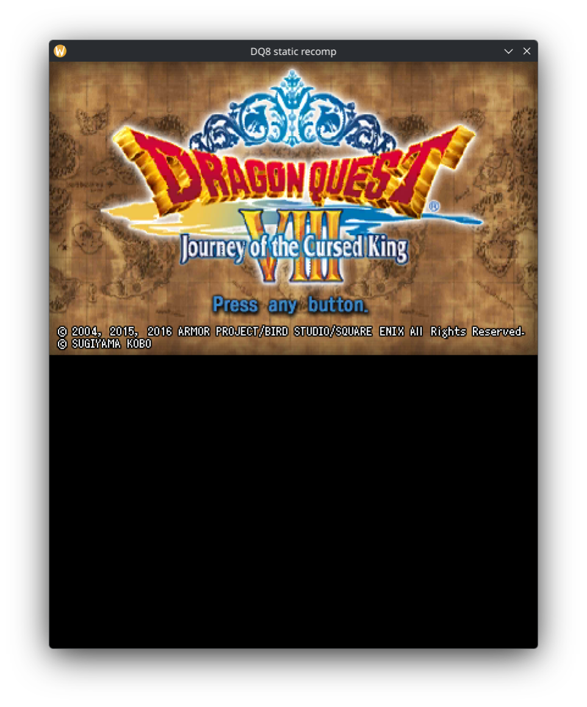
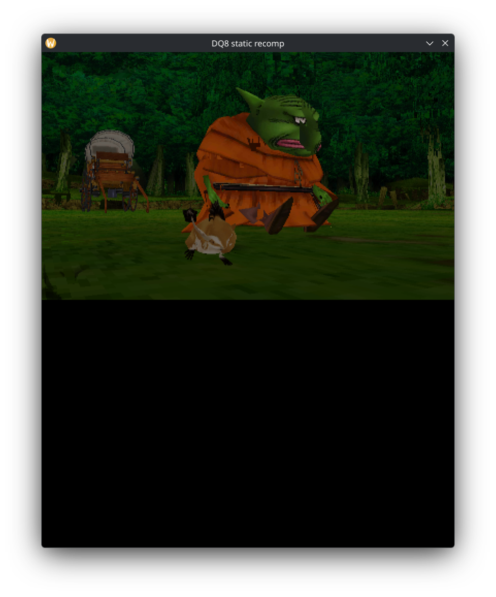

# DQ8-3DS-Recomp

**Dragon Quest VIII: Journey of the Cursed King (3DS) — статическая рекомпиляция в C, нативный запуск на PC.**

Проект берёт собственный ARM-код игры, статически рекомпилирует его в переносимый C, линкует с
нативным рантаймом (ввод, аудио, файловая система, сейвстейты) и собственным рендерером PICA200
(GPU Nintendo 3DS) с бэкендом OpenGL — и запускает игру как обычное настольное приложение.

> **В разработке.** Игра загружается: вступительный ролик, меню, 3D-мир и внутриигровые диалоги
> рисуются и работают; производительность и корректность рендера продолжают дорабатываться.

> **Юридическое примечание.** В репозитории **нет никаких данных игры** — ни ROM, ни `code.bin`, ни
> `romfs`, ни сейвов. Файлы нужно извлечь из **вашей собственной, легально приобретённой копии**
> игры. Проект предназначен для сохранения и исследований.

---

## Скриншоты


*Титульный экран*


*3D-мир — встреча в лесу*

## Содержание

- [Что нужно](#что-нужно)
- [Подготовка игровых файлов](#подготовка-игровых-файлов)
- [Сборка](#сборка)
- [Запуск](#запуск)
- [Сейвстейты](#сейвстейты)
- [Аргументы командной строки](#аргументы-командной-строки)
- [Переменные окружения](#переменные-окружения)
- [Структура проекта](#структура-проекта)

---

## Что нужно

**Игровые файлы (ваши, легально приобретённые):**
- `DQ8.code` — `code.bin` игры (ARM-исполняемый файл) из *Dragon Quest VIII — Journey of the Cursed
  King* (3DS, версия USA)
- `dq8.romfs` — образ RomFS игры (файловая система), извлечённый из того же дампа

**Инструменты сборки:**
- Clang (C11)
- Rust / Cargo (драйвер рекомпилятора)
- Python 3 (генерация кода)
- SDL2 (окно, ввод, звук)
- OpenGL 4.x / EGL (аппаратный рендеринг; есть програмная альтернатива)

**Среда:**
- Linux или Windows (X11 или Wayland в Linux; проверенный путь — X11)

---

## Подготовка игровых файлов

Извлеките из собственного картриджа/дампа (например, GodMode9 на 3DS или `ctrtool`/`3dstool` на PC):

```
ваш-дамп/
├── code.bin      →  сохранить как  DQ8.code
└── romfs.bin     →  сохранить как  dq8.romfs
```

Оба файла могут лежать в любом месте — их пути передаются бинарю при запуске. **Они никогда не
являются частью репозитория и не должны в него попадать.**

---

## Сборка

Профилей два. Генерируемый C у них одинаковый, разница — в одном флаге: уровне оптимизации
рекомпилированного гостевого кода.

```sh
# Профиль разработки — гостевой код на -O0.
# Инкрементальная сборка занимает секунды, полная — около 2 минут.
BUILD_JOBS=$(nproc) bash tools/build_split.sh target/dq8

# Релизный профиль — гостевой код на -O1.
# Полная сборка занимает около 2 часов; см. цифры ниже, прежде чем включать.
BUILD_JOBS=$(nproc) bash tools/build_release.sh target/dq8-rel
```

Скрипт сборки заново генерирует C из `DQ8.code`, режет его на 36 единиц трансляции и
компилирует всё Clang'ом. Неизменённые единицы переиспользуются, поэтому инкрементальные
пересборки быстрые.

### Почему `-O1` — отдельный профиль

Замеры на Radeon RX 580, сцена «поле», по 25 с на прогон, интерливинг:

| | dev (`-O0`) | release (`-O1`) |
|---|---:|---:|
| время гостя на кадр | 12.12 мс | **10.70 мс** (−11.7%) |
| p90 кадра | 43.4 мс | 37.2 мс |
| кадров дольше 33.4 мс | 37–40% | 27–31% |
| размер бинаря | 171 МБ | 42 МБ |
| полная пересборка | ~2 мин | **~2 часа** |

Выигрыш реальный, но цена сборки жёсткая: одна единица трансляции (`dq8_part_039`, самая
плотная страница транслированного кода) занимает в `-O1` около 50 минут. Поэтому повседневные
итерации остаются на `-O0`, а `-O1` — для релизов и измерительных прогонов.

### Кеш объектов и переключение профилей

Оба профиля используют один каталог объектов (`target/dq8-split/obj`). Переключение профиля
инвалидирует все 36 гостевых единиц, поэтому первая сборка после переключения всегда полная.
Если нужно собирать оба профиля одновременно — берите два отдельных чекаута (или `git worktree`),
иначе они будут затирать кеш друг друга.

---

## Запуск

```sh
./target/dq8 /путь/к/DQ8.code /путь/к/dq8.romfs
```

В Linux, если окно чёрное под Wayland, принудительно включите X11:

```sh
SDL_VIDEODRIVER=x11 ./target/dq8 DQ8.code dq8.romfs
```

При первом запуске игра создаёт свой ExtData, когда просит об этом (отвечайте на игровые запросы
кнопкой **A**), затем идёт через вступительный ролик к титульному экрану.

---

## Сейвстейты

Полный снимок машины (гостевая RAM + потоки + состояние сервисов) сохраняется и загружается в любой
момент:

| Ключ / флаг | Действие |
|---|---|
| **F5** | сохранить снимок (по умолчанию — рядом с бинарём) |
| **F9** | загрузить снимок (мгновенный возврат в момент сохранения) |
| `--load-state ПУТЬ` / `--state ПУТЬ` | загрузить снимок при старте — **сразу вход в сохранённую сцену** (без всей загрузки) |
| `DQ8_STATE_DIR=ПАПКА` | папка для файлов снимков (по умолчанию — рядом с бинарём) |
| `DQ8_STATE_FILE=ФАЙЛ` | явный путь к файлу снимка |
| `DQ8_LOAD_STATE=ФАЙЛ` | env-аналог `--load-state` |
| `DQ8_SAVESTATE_AUTOSAVE_AT=N` | автоматически сохранить снимок на гостевом шаге N |
| `DQ8_SAVESTATE_AUTOLOAD_AT=N` | автоматически загрузить снимок на гостевом шаге N |

Пример — мгновенный вход в игровую сцену для тестов:

```sh
./target/dq8 --load-state my-state.sav DQ8.code dq8.romfs
```

---

## Аргументы командной строки

```
dq8 DQ8.code DQ8.romfs [--load-state ПУТЬ] [--state ПУТЬ]
```

| Аргумент | Значение |
|---|---|
| `DQ8.code` | путь к `code.bin` игры (позиционный, обязателен) |
| `DQ8.romfs` | путь к образу RomFS (позиционный, обязателен) |
| `--load-state ПУТЬ` | загрузить сейвстейт при старте |
| `--state ПУТЬ` | синоним `--load-state` |

Флаги можно ставить до, между и после позиционных аргументов.

---

## Переменные окружения

Всё поведение задаётся переменными `DQ8_*`. Все необязательны.

### Ядро / выполнение

| Переменная | Значение |
|---|---|
| `DQ8_RUN_GUEST_THREADS=1` | гостевые потоки = хостовые потоки (рекомендуется; всегда используется в тестах) |
| `DQ8_HEADLESS=1` | безголовый режим — без окна и SDL-видео |
| `DQ8_DISPLAY=1` | принудительно создать дисплей (окно) |
| `DQ8_S1_CFG=...` | конфигурация рекомпиляции S1 (`all` или список регионов через запятую) |
| `DQ8_S1_CFG_END=...` | конечные адреса для списка регионов S1 |
| `DQ8_USER_DATA_DIR=ПАПКА` | где живут сейв/ExtData игры (по умолчанию `userdata/`) |
| `DQ8_GUEST_TIME=...` | управление тактированием гостевых часов |
| `DQ8_VBLANK_WALLCLOCK=1` | каденция vblank 60 Гц по настенным часам, а не из цикла отрисовки (по умолчанию; держит гостевые часы корректными на медленных GPU) |
| `DQ8_IDLE_THROTTLE=...` | троттлинг простаивающих кадров (включается только на побайтово статичном экране без ввода; `0` отключает полностью) |
| `DQ8_FRAMEPROF=1` | разбивка по кадрам в stderr (`total/guest/gl/present/audio/idle`) — первое, что стоит включить при поиске просадок |
| `DQ8_STACK_NO_RELOCATE=1` | отключить перенос гостевых стеков потоков |
| `DQ8_STRICT_NULL_CALLBACK=1` | строгий трэп NULL-колбэков (отладка) |

### Рендеринг (GL-бэкенд)

| Переменная | Значение |
|---|---|
| `DQ8_GL=1` | включить OpenGL-рендерер (выкл = программный растеризатор) |
| `DQ8_GL_FBFETCH=on/off` | framebuffer-fetch (`imageLoad` живого render target, с texture barriers). **По умолчанию включён на проверенных драйверах**: llvmpipe, softpipe, swrast и radeonsi (AMD/Mesa); на непроверенных драйверах остаётся путь с копированием на каждый драв, пока не задан `=1`, а `=0` принудительно включает копирование везде |
| `DQ8_GL_BATCH=...` | управление батчингом дравов |
| `DQ8_GL_BLENDS=on/off` | факторы/уравнения блендинга PICA на GPU (fixed-function GL). **По умолчанию включён**; `DQ8_GL_BLENDS=0` возвращает шейдерный (программный) путь блендинга |
| `DQ8_GL_CTX_HOLD=...` | держать GL-контекст привязанным (без лишних MakeCurrent) |
| `DQ8_GL_ZCLEAR=...` | политика очистки depth |
| `DQ8_GL_DSTALWAYS=...` | переопределение обработки dst-альфы |
| `DQ8_GL_SKIP=...` | пропуск классов дравов (отладочный вентиль) |
| `DQ8_GL_TEXCACHE=...` | кеш текстур: вкл/выкл/настройка |
| `DQ8_GL_TEXMEM_MB=N` | бюджет кеша текстур (МБ) |
| `DQ8_GL_TEXCONTENT=...` | переиспользование текстур по содержимому |
| `DQ8_GL_TEXDECODE=...` | выбор декодера текстур (быстрый/эталонный) |
| `DQ8_GL_TEXKEY=...` | политика ключей кеша текстур |
| `DQ8_GL_TEXSTATS=1` | печатать статистику кеша текстур |
| `DQ8_GL_DEBUG=1` | отладочный вывод GL |
| `DQ8_GL_RECT_TRACE=1` | трейс прямоугольных дравов |
| `DQ8_GL_NOIMGBIND=1` | отключить image-load привязки (совместимость) |
| `DQ8_GL_DUMP_DIR=ПАПКА` | дамп GL-артефактов для отладки |
| `DQ8_BLEND_FAST=1` | быстрое приближение блендинга |
| `DQ8_SPLIT_GL=1` / `DQ8_SPLIT_RENDER=1` | режимы разделённого конвейера рендера |
| `DQ8_ELIDE_RASTER=...` | пропуск растеризации (перф-эксперименты) |
| `DQ8_ELIDE_TRACE=...` / `DQ8_ELIDE_VERIFY=...` | трейс/верификация пропусков |
| `DQ8_IGNORE_LCD_BLACK=1` | игнорировать чёрные LCD-кадры при презенте |

### Ввод

| Переменная | Значение |
|---|---|
| `DQ8_INPUT_FILE=ФАЙЛ` | живой файл ввода: первая строка — hex-маска кнопок, читается каждый кадр (автоматизация/тесты) |
| `DQ8_TRACE_INPUT=1` | логировать нажатия кнопок |
| `DQ8_TRACE_HID_READS=1` | логировать чтения HID гостем |

### Аудио

| Переменная | Значение |
|---|---|
| `DQ8_AUDIO_SDL=...` | управление SDL-аудио-выводом |
| `DQ8_AUDIO_POLL_US=N` | интервал опроса аудио (мкс) |
| `DQ8_AUDIO_WAKE_MODE=...` | режим пробуждения/диспатча аудио |
| `DQ8_AUDIO_DUMP=...` | дамп декодированного аудио |
| `DQ8_DSP_DUMP=...` | дамп DSP-трафика |
| `DQ8_DSP_SE_DIR=ПАПКА` | папка со звуковыми эффектами |
| `DQ8_AUDIO_TEST_DELAY_NS=N` | тестовый хук: искусственная задержка аудио |

### Ролики / медиа

| Переменная | Значение |
|---|---|
| `DQ8_SKIP_MOVIE=1` | полностью пропустить вступительный ролик (лого → титул) |
| `DQ8_TRACE_MOVIE=...` | трейс видеоплеера |
| `DQ8_TRACE_Y2R=...` | трейс блока Y2R (видеоконвертация) |
| `DQ8_DUMP_Y2R_PREFIX=P` | дамп кадров Y2R |

### Захват / статистика

| Переменная | Значение |
|---|---|
| `DQ8_CAPTURE_PPM=1` | периодические PPM-захваты кадров (собственный фреймбуфер рендерера, не скриншоты) |
| `DQ8_CAPTURE_PPM_DIR=ПАПКА` | куда их писать |
| `DQ8_CAPTURE_STATS=1` | статистика захвата |
| `DQ8_FRAME_STATS=1` | периодические строки `FRAMESTAT`: дравы, треугольники, попадания/промахи кеша текстур, доля идентичных кадров |
| `DQ8_PROGRESS_SECONDS=N` | строка прогресса гостя каждые N секунд |
| `DQ8_DEBUG_LOGO_OVERLAY=1` | отладочный оверлей |
| `DQ8_SCAN_MSG=1` / `DQ8_SCAN_UI_HEAP=1` | диагностика сканирования UI/сообщений |
| `DQ8_GEOM_DUMP=...` | дамп геометрии |
| `DQ8_FIND_FLOATS=...` / `DQ8_FIND_ON_COUNT=N` | отладочные помощники сканирования памяти |

### Дампы

| Переменная | Значение |
|---|---|
| `DQ8_DUMP_GUEST_DIR=ПАПКА` | папка дампов гостевой памяти |
| `DQ8_DUMP_PICA=...`, `DQ8_DUMP_PICA_ALL=1` | дамп командных списков PICA |
| `DQ8_DUMP_PICA_COUNT=...`, `DQ8_DUMP_PICA_COUNT_DIR=...` | счётчик PICA-дампов |
| `DQ8_DUMP_TRANSFER_LATEST=1`, `DQ8_DUMP_TRANSFER_PREFIX=P` | дамп display-трансферов |

### Бенчмаркинг / тесты

| Переменная | Значение |
|---|---|
| `DQ8_BENCH_STEPS=N` | выполнить N гостевых шагов и выйти (бенчмарк) |
| `DQ8_BENCH_NO_SNAPSHOT=1` | отключить снапшоты при бенчмарках |

### Трейсинг (`DQ8_TRACE_*`)

Глубокая диагностика; каждый флаг логирует одну подсистему в stderr. Основные:

| Переменная | Что трейсит |
|---|---|
| `DQ8_TRACE_PC`, `DQ8_TRACE_PC_MAX` | поток гостевых PC |
| `DQ8_TRACE_BRANCH` | решения ветвлений |
| `DQ8_TRACE_THREADS`, `DQ8_TRACE_THREAD_ID` | планирование потоков |
| `DQ8_TRACE_IPC`, `DQ8_TRACE_ARBITER`, `DQ8_TRACE_ARBITER_ADDRESS` | IPC ядра / ожидания арбитра |
| `DQ8_TRACE_WAIT` | семантика объектов ожидания |
| `DQ8_TRACE_FS`, `DQ8_TRACE_FS_SERVICE` | файловый сервис |
| `DQ8_TRACE_GPU`, `DQ8_TRACE_LAYER`, `DQ8_TRACE_BFLYT` | GPU / композиция слоёв |
| `DQ8_TRACE_GSP_FB` | учёт фреймбуферов GSP |
| `DQ8_TRACE_TEV`, `DQ8_TRACE_TEXCFG` | конфигурация TEV / текстур |
| `DQ8_TRACE_CLIPTRI`, `DQ8_TRACE_CLIPSTAT` | клиппинг примитивов |
| `DQ8_TRACE_VSDRAW`, `DQ8_TRACE_VSDUMP`, `DQ8_TRACE_VSDVERT`, `DQ8_TRACE_VSDLIVE`, `DQ8_TRACE_VSDDEAD`, `DQ8_TRACE_VSDMAX`, `DQ8_TRACE_VSDT0`, `DQ8_TRACE_VSDT1`, `DQ8_TRACE_VSFAIL` | форензика выходного маппинга вершинного шейдера |
| `DQ8_TRACE_SWFALL` | причины фолбэка в программный растеризатор |
| `DQ8_TRACE_TIME` | тайминг по фазам |
| `DQ8_TRACE_UNIDRAW`, `DQ8_TRACE_UNIDRAW_MAX` | объединённый трейс дравов |
| `DQ8_TRACE_VBUF`, `DQ8_TRACE_PX`, `DQ8_TRACE_RECT` | вершинные буферы / пиксели / прямоугольники |
| `DQ8_TRACE_WRITE` | записи в гостевую память |
| `DQ8_TRACE_OBJECT`, `DQ8_TRACE_UI_OBJECT`, `DQ8_TRACE_STRING_OBJECT`, `DQ8_TRACE_SELECTION` | сканирование объектов/UI |
| `DQ8_TRACE_FORMAT_ARGS`, `DQ8_TRACE_FORMAT_PATH`, `DQ8_TRACE_FORMAT_SINK` | отладка format-строк |
| `DQ8_TRACE_SARC_LOOKUP`, `DQ8_TRACE_LOOKUP` | поиск в архивах |
| `DQ8_TRACE_AUDIO` | аудиоконвейер |
| `DQ8_ZWRITE0_TRACE` | крайние случаи растеризации с нулевой записью |

---

## Структура проекта

```
├── src/
│   ├── main.rs              # драйвер рекомпилятора + склейка сгенерированного рантайма
│   ├── block_emit.rs        # эмиттер блоков кода
│   ├── block_ir.rs          # промежуточное представление блоков
│   ├── native_*.c           # нативный рантайм: аудио, ФС, HID, сейвстейты, презент
│   ├── pica_gl.c            # рендерер PICA200 → OpenGL
│   └── pica_vs.c            # вершинная стадия (маппинг выходов, клиппинг)
├── tools/
│   ├── build_split.sh       # полная сборка: генерация C → нарезка → компиляция
│   ├── split_dispatch.py    # генерация кода с нарезкой диспатча
│   └── ...                  # пробы, тестовые харнесы, диагностика
├── docs/                    # дизайн-заметки и документы по реализации
├── Cargo.toml               # драйвер рекомпилятора
└── recomp-roots.txt         # конфигурация корневых адресов рекомпиляции
```

---

## Английская версия

См. [README.md](README.md).
